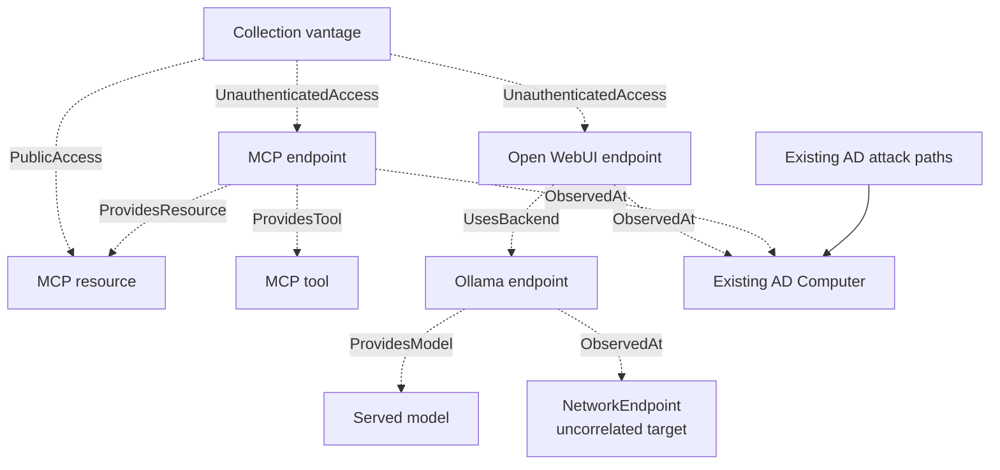

# LLMHound graph model

> **Status: M1 primitives and emission implemented.** Companion to the
> [design plan](../plans/2026-09-29-llmhound-design.md).
> `internal/graph` implements identity, kind mapping and observation primitives;
> `internal/correlate` implements input-only correlation; `internal/emitter` and
> `internal/evidence` implement OpenGraph payload emission and evidence sidecars;
> `extension/schema.json` defines the OpenGraph schema. Collectors and CE API
> integration remain separate milestones.
> [M0](ce-compatibility.md) validated the required semantics on CE 9.7.1.

LLMHound collects AI-infrastructure observations for BloodHound and downstream
inventory enrichment through anonymous, bounded, read-only collection.
The extension/source identifier and `source_kind` are `LLMHound`.
Code uses clean logical kind names; CE 9.7.1 requires emitted names to carry
`LLMHound_` (for example, `LLMHound_OllamaInstance`).

## Naming contract

- **Kinds:** logical names such as `OllamaInstance`, `MCPServer` and
  `ObservedAt` are centrally mapped by `internal/graph/kinds.go` to
  `LLMHound_<Kind>`. Native `Computer` remains unqualified and is never emitted
  as a source-owned node. Saved queries and schema definitions must use the
  emitted names, per [M0 Q1](ce-compatibility.md).
- **Display names:** describe the instance, for example
  `Ollama · ai-server-01:11434`, without a collector prefix.
- **Ownership:** retain `LLMHound` in extension/source metadata. Cleanup must
  use validated source ownership, never a kind-name prefix.
- **Adapter mapping:** M0 confirmed a global namespace and mandatory,
  exclusively owned extension prefix. Schema definitions, payloads and saved
  queries must share the mapping above. An untested CE release still requires
  adapter validation; the local kind mapping is not a compatibility claim
  for every release.
- **Identity:** the versioned identity tuple includes the stable source identifier,
  deployment scope, and logical kind. Adapter qualification and display-name
  changes do not change object IDs. Source identity prevents cross-collector
  collisions without putting collector branding in every kind.

These tables show logical names, not the unqualified strings to send to CE.
M0 recorded namespace/collision behavior; the release gate must validate the
finished extension and consistent mapping before declaring release support.

## At a glance

All arrows below represent **non-traversable evidence or topology**, scoped
to the recorded collection vantage and operation.



Correlated targets attach to the `Computer` nodes already in BloodHound, so
AI services appear on machines that existing AD attack paths reach.
Correlation is neither an access grant nor a traversable attack transition.

## Nodes

| Group               | Kinds                                                                                                                                      |
| ------------------- | ------------------------------------------------------------------------------------------------------------------------------------------ |
| Observation context | `CollectionVantage`                                                                                                                        |
| Observed targets    | existing AD `Computer` (correlated, not emitted), `NetworkEndpoint` (fallback)                                                             |
| MCP                 | `MCPServer`, `MCPTool`, `MCPResource`, `MCPPrompt`                                                                                         |
| A2A                 | `A2AAgent`, `A2ASkill`                                                                                                                     |
| AI services         | `OllamaInstance`, `VLLMInstance`, `LiteLLMGateway`, `QdrantInstance`, `MLflowServer`, `JupyterServer`, `OpenWebUIInstance`, `LangServeApp` |
| AI services (M2c)   | `OpenAICompatibleEndpoint`, `RayDashboard`, `LangflowInstance`, `FlowiseInstance`, `ChromaInstance`                                        |
| Served models       | `AIModel`                                                                                                                                  |
| Typed resources     | `VectorCollection`, `WorkspaceFile`, `ModelArtifact`, `ArtifactStore`                                                                      |
| Umbrella label      | `AIService`                                                                                                                                |

In the edge tables, **service** means an MCP server, A2A agent, or AI-service
endpoint, not its child tools, skills, or resources.

### Observation context and targets

- **`CollectionVantage`** identifies a configured scanner/network
  context. Its stable key is operator-supplied and scoped to the deployment;
  scan IDs and timestamps are not its identity. Different network contexts
  must not share a vantage key. It is not an attacker principal.
- **`Computer`** (existing AD node, not emitted by LLMHound) is the
  preferred `ObservedAt` target when correlation succeeds; see
  [Computer correlation](#computer-correlation).
- **`NetworkEndpoint`** is the fallback for an observed IP or FQDN target
  that did not correlate. It is not necessarily an authoritative machine and
  may identify a proxy, load balancer, or shared address. Retain the original
  target, normalized hostname, resolved addresses, and observation time
  without claiming that DNS resolution proves identity.
- IP and FQDN `NetworkEndpoint` nodes are not automatically merged with each
  other; ambiguous candidates remain unresolved.

### Services

- **`MCPServer`** represents a fingerprinted network MCP endpoint.
  Enumerated tools, resources, and prompts become their respective child nodes.
- **`A2AAgent`** represents an agent advertised by an agent card;
  advertised skills become `A2ASkill` nodes. Advertisement is not
  evidence of successful invocation.
- **`OpenAICompatibleEndpoint`** (M2c) represents an endpoint that exposes an
  OpenAI-compatible API shape when no specific product (vLLM, LiteLLM,
  llama.cpp, TGI, …) can be proven. It is the honest default, not a guess.
- **AI service kinds** each represent a fingerprinted service endpoint, not a
  guaranteed unique process or installation. Multiple endpoints may eventually
  be correlated to one deployment without rewriting observation identity.
- **`AIService`** is the second kind on every concrete service node, not a
  separate node or identity owner. M0 verified multi-kind support and querying;
  the emitted umbrella label is `LLMHound_AIService`.
- An advertised backend URL alone does not establish its product or availability.
  Keep it as a sanitized dependency reference until independently fingerprinted;
  only then emit a typed service-to-service `UsesBackend` edge. Never scan a
  backend merely because it was advertised; normal target authorization applies.

### Models and resources

- **`AIModel`** is a model served by a runtime, scoped to that service.
  Record a digest when available; a mutable model tag is not immutable content.
- **`VectorCollection`** is a Qdrant collection. Individual point
  references, if collected, remain bounded properties rather than nodes in v1.
- **`WorkspaceFile`** is a Jupyter notebook/file reported by the contents
  API. Listing a path is distinct from successfully reading its content.
- **`ModelArtifact`** is a registered MLflow model version.
- **`ArtifactStore`** is a reported storage root. Bucket names and
  filesystem paths do not establish access or global uniqueness; v1 scopes these
  nodes to the reporting service. Shared-store resolution belongs downstream.

## Identity and correlation contract

Use SHA-256 over an unambiguously serialized, versioned identity tuple. Every
identity includes the source identifier, deployment/tenant scope, and concrete
logical node kind. Scope is
stable configuration, not a secret or a per-scan UUID.

| Node                 | Additional identity fields                                                 |
| -------------------- | -------------------------------------------------------------------------- |
| Collection vantage   | Configured stable vantage key                                              |
| NetworkEndpoint      | Normalized target type and target value                                    |
| Service              | Canonical endpoint: scheme, hostname/IP, effective port, service base path; optional configured instance key |
| Child resource/model | Owning service ID and exact stable resource key                            |

Resource keys include collection name, model name, MCP resource URI/tool name,
workspace path, or registered model name and version. Preserve case where the
protocol is case-sensitive. Normalize DNS case and IP representation without DNS
resolution. Do not collapse distinct virtual hosts or path-mounted services. Credentials, fragments, request
query strings, display names, observed software versions, timestamps and
descriptions do not enter endpoint identity. A registered model's artifact
version can be part of its stable resource key; that is not a software version.

### Implemented identity v1

`internal/graph/identity.go` hashes a JSON string-array tuple beginning with
`["1", "LLMHound", deployment_scope, logical_kind, ...]`; SHA-256 hex is
upper-case to match M0's node-ID ingest normalization. Native Computer IDs are
preserved verbatim, not passed through this hash or rewritten. Resource ownership
is the scoped concrete service ID. Stable keys retain case and are not trimmed.

`ParseEndpoint` accepts HTTP(S) and defines these normalization rules:

- DNS names are ASCII (use A-labels for international names), lower-case and
  without a single terminal root dot; IPs use canonical `net/netip` spelling.
  Zoned IP literals and malformed numeric addresses are rejected, including
  hostnames whose final label is all digits or starts with `0x`
  (`example.123`, `0x7f.0.0.1`).
- Omitted ports are 80/443; explicit default ports and leading-zero decimal
  spellings normalize to the same effective port. Schemes stay distinct.
- Empty path and `/` are equivalent. Unreserved percent escapes normalize to
  literal characters; remaining escapes use upper-case hex. Escaped `/` is not
  a path separator. Path case, non-root trailing slash, repeated slash and dot
  segments are preserved: their server semantics may differ.
- Userinfo and fragments fail closed. A query-bearing endpoint requires an
  explicit stable **non-secret instance key**; the key enters identity but the
  query is neither retained nor hashed. Different query-selected instances must
  get different keys. `Endpoint.String()` is a sanitized canonical URL, not a
  representation of the instance key; keep that key separately when rebuilding
  identity. Mutable credentials/query values must not become instance keys.

`ParseTarget` accepts bare DNS/IP targets independently of service URLs.
IP/FQDN coincidence, shared certificates and redirects never unify identities.

Repeated observations of the same identity retain its ID. This does not prove
that an IP-backed installation stayed the same over time. Preserve temporal
observations rather than treating endpoint identity as a permanent machine ID.

## Computer correlation

LLMHound extends an existing BloodHound buildout: observed targets dedup
against AD `Computer` nodes rather than creating a parallel host graph.

| Precedence | Source | Matches on | Notes |
|---|---|---|---|
| 1 | Explicit operator mapping data | target → existing Computer objectid/SID | Requires destination existence in the caller's verified inventory; the only implemented IP-only path |
| 2 | AD domain-suffix FQDN | exact stored Computer `name` | Explicitly enable M0 property-match support; use upper-case canonical FQDN and require exactly one verified candidate |
| 3 | CE API lookup (M3; not implemented here) | exact objectid resolved pre-scan | Optional; needs a read-only CE token |
| — | Reverse DNS (future opt-in; not implemented here) | PTR → FQDN, then rule 2 | Off by default; would be recorded as a weaker method |

- `internal/correlate` takes mapping entries, configured AD suffixes and an
  externally verified inventory of existing Computers. It does not read files,
  query CE, resolve DNS or invent a lookup. The inventory must include all
  candidates relevant to a matcher; an incomplete/stale subset cannot prove
  uniqueness. Empty inventory never proves a match.
- A successful decision returns an existing native reference and `ObservedAt`
  (service → `Computer`) with match method/value/confidence. No fallback node
  identity is returned. Mapping references use `match_by: id`; suffix references
  use `match_by: property`, `kind: Computer`, `name` equals the upper-case FQDN.
  Only `name` is supported: M0 did not validate `dNSHostName` semantics.
- A suffix must have a DNS label boundary and a child hostname: `host.lab.local`
  is inside `lab.local`, but `lab.local`, `notlab.local` and
  `host.lab.local.other` are not. IP-only targets never become name matches.
- No match, disabled property support, suffix mismatch, unverified mapping
  destination or ambiguity returns a scoped `NetworkEndpoint`. Reasons and
  sorted candidate IDs are retained in correlation evidence for a future
  sidecar writer. An unresolved/ambiguous explicit mapping does not silently
  fall through to the weaker suffix rule. Duplicate identical records dedup;
  conflicting records for one native ID are rejected.
- Existence and uniqueness are checked before constructing native references:
  M0 showed missing ID endpoints materialize stubs and zero/multiple property
  matches silently drop edges. Accepting a payload alone cannot verify a match.
- Correlation is an **edge to an existing node, not an identity merge**.
  Service objectids never depend on it, native BloodHound IDs are never
  overwritten, and LLMHound cleanup never removes or modifies `Computer` nodes.
- A rescan that newly correlates a target attaches to the Computer; the old
  `NetworkEndpoint` is left for the ingest lifecycle policy to retire.

## External asset references

Allow source-qualified external asset references supplied by the ingest pipeline
(e.g. source deployment plus Axonius asset ID, BloodHound node ID, AD SID, or
cloud instance ID). Record mapping method, time, and confidence separately.
LLMHound does not discover these identifiers unless an authorized source exposes
them. FQDN/name matches are candidates, not unconditional identity merges.
Never overwrite native BloodHound identifiers with LLMHound hashes.

## Edges

### Topology (non-traversable)

| Edge               | Source → target          | Meaning                                                                                 |
| ------------------ | ------------------------ | --------------------------------------------------------------------------------------- |
| `ObservedAt`       | service → Computer / NetworkEndpoint | Fingerprinted endpoint was observed through this target (correlated Computer or fallback) |
| `RunsOn`           | service → Computer / NetworkEndpoint | Reserved for supported runtime placement; listening at an address alone is insufficient |
| `ProvidesTool`     | MCPServer → MCPTool      | Tool enumerated, not executed                                                           |
| `ProvidesResource` | MCPServer → MCPResource  | Resource enumerated, not necessarily read                                               |
| `ProvidesPrompt`   | MCPServer → MCPPrompt    | Prompt enumerated                                                                       |
| `ProvidesModel`    | service → AIModel        | Model advertised by the runtime; inference not implied                                  |
| `AdvertisesSkill`  | A2AAgent → A2ASkill      | Skill advertised, not invoked                                                           |
| `UsesBackend`      | service → service        | Explicit dependency reported by the source, not proof of backend access                 |
| `Contains`         | service → typed resource | Collection, workspace, model artifact, or reported artifact store association           |

### Access observations (also non-traversable in v1)

| Edge                    | Source → target                 | Meaning                                                                          |
| ----------------------- | ------------------------------- | -------------------------------------------------------------------------------- |
| `UnauthenticatedAccess` | CollectionVantage → service     | A specific enumeration operation succeeded without credentials from this vantage |
| `PublicAccess`          | CollectionVantage → readable resource | A specific resource read succeeded without credentials from this vantage         |

`PublicAccess` means anonymous access from the recorded vantage, **not internet
exposure**. A denied control read is not required to record a successful anonymous
read. Neither edge represents arbitrary API use, code execution, or control of
the service. Preserve operation-level evidence; an HTTP 200 login page is not
successful enumeration. Different operations may have different access outcomes.

The earlier host-to-service access edge is intentionally replaced: the collector
observed scanner access, not access originating from the hosting machine.
The graph still supports exposure and inventory queries without enabling these
edges in attack-path search. `NewAccessEdge` requires validated anonymous success,
check ID, exact operation/target, original observation and matching vantage.
Enumeration and resource-read evidence are distinct; TCP probes, declarations,
negative/unknown outcomes and reversed directions cannot create access edges.
Readable targets are `MCPResource`, `WorkspaceFile`, `ModelArtifact`,
`ArtifactStore` and `VectorCollection`; their sensitive reads still require the
collector's independent opt-in and bounds. `NewTopologyEdge` cannot bypass these
requirements and rejects the reserved `RunsOn` kind.

Topology and identity mappings remain non-traversable regardless of the
metadata attached to their endpoints.

## Evidence and enrichment contract

These are logical fields; the adapter must define schema-supported serialization
rather than assuming arbitrary nested properties work in OpenGraph. Graph
properties stay flat and queryable (driven by the
[saved queries](saved-queries.md)). Bounded structured evidence that graph
properties cannot represent goes to the `.evidence.jsonl` sidecar emitted with
each payload; graph entries reference it by stable evidence ID.

| Field group         | Required meaning                                                                                                   |
| ------------------- | ------------------------------------------------------------------------------------------------------------------ |
| Provenance          | Schema version, deployment scope, scan ID, collector/version, evidence ID, source and vantage                      |
| Timing              | Observation time in UTC; first/last seen when maintained by a stateful owner                                       |
| Endpoint            | Canonical scheme/host/port/base path plus observed address and sanitized original target                           |
| Fingerprint         | Product/vendor, reported version when available, raw non-secret version text, identification method and confidence |
| Access              | Operation, target, anonymous authentication context, success/denied/unknown outcome, bounded supporting evidence   |
| Dependencies        | Reported backend/storage references, reporting source, and whether independently observed                          |
| Correlation         | Computer match method/value/confidence, or fallback reason and ambiguous candidates                                |
| External references | Source-qualified asset IDs and mapping provenance when supplied                                                    |
| Coverage            | Collection surface, outcome, truncation limits, and failure reason where applicable                                |

Missing version information is **unknown**, not a guessed version. Record
conflicting fingerprints rather than silently selecting whichever observation
arrived last. Every collector must attempt documented version discovery and
record its outcome; successful version discovery is not guaranteed.

### Expanded metadata contract

The [collector capability matrix](collector-capabilities.md) defines required
checks, default metadata collection, and optional sensitive reads for every
surface. Enrichment stays on existing nodes and evidence records; it does not
require new node kinds for every header, version, or check.

- **Component versions:** preserve `product`, `vendor`, `software_version_raw`,
  optional normalized `software_version`, `build_id`, `commit`, and `image_digest`
  when explicitly reported. Store `api_version` and `protocol_version` separately.
  Each value retains its component/endpoint, source field/operation, confidence,
  and observation time. A proxy banner is not a backend version.
- **Capabilities:** MCP tools retain bounded descriptions, input schemas, and
  advertised annotations; resources retain URI schemes/templates; A2A skills
  retain advertised descriptions and security requirements. Label these values
  as declarations, not observed behavior. Bound nested schemas and descriptions.
- **Models/artifacts:** retain reported model family, format, quantization, size,
  digest, alias, upstream artifact/repository reference, and registry lifecycle
  metadata. Keep reported alias-to-backend mappings separate from verified
  identity. Software versions, registry versions, and model digests are distinct.
- **Deployment/dependencies:** preserve explicitly reported instance/deployment
  identifiers and backend/provider/storage references, with provenance and
  independent-observation status. Sanitize references without following them.
- **TLS/endpoints:** retain leaf certificate fingerprint, issuer, subject/SANs,
  validity, verification result/reason, negotiated TLS version when available,
  and authorized redirect observations. Record an insecure override separately;
  it is not successful verification. Certificate sharing never merges assets.

These fields are optional values with explicit availability, not a requirement to
invent metadata a product does not expose. Logical field serialization follows
the schema-supported evidence contract above.

### Per-check results

Each configured check records `check_id`, target, scan ID, vantage, operation,
sanitized source, observation time, outcome, reason, and evidence references.
Outcomes are `success`, `denied`, `unsupported`, `failed`, or `skipped`, as defined
in the capability matrix. Keep them separate from enumeration coverage: a
successful listing can still be truncated. A 404 alone is not proof of an
unsupported feature, and missing optional version data can coexist with a
successful metadata response.

Retain operation-specific access outcomes rather than overwriting one global
anonymous-access flag. Negative/unknown results belong in evidence records,
not positive access edges. Preserve sufficient metadata to compare versions,
backend references, model digests, and inventories across compatible scan scopes
and vantages without treating failed collection as disappearance. (A comparison
tool itself is deferred; v1 only retains the data.)

Use allowlisted metadata and bounded evidence summaries. Strip credentials,
authorization headers, URL userinfo, signed query parameters, and other secrets.
Do not retain full response bodies by default. Sensitive prompts, configuration,
and workspace contents need explicit collection/retention controls; metadata
should remain useful without them. These safeguards apply to checkpoints and
logs as well as exported payloads.

### Coverage and lifecycle

Coverage is per collection surface and operation, not a blanket claim that the
service or host has been completely assessed:

- `complete`: the configured collection surface was fully enumerated.
- `partial`: some operations failed; successful observations remain valid.
- `truncated`: a configured size/page bound stopped enumeration; retain any
  additional errors and limit details separately.
- `failed`: the attempted surface could not be enumerated, including an
  unreachable endpoint. Discovery failures do not create fingerprinted services.

Rescans must not turn old success into fresh success. Keep the last successful
observation separate from the latest attempt and its outcome. Absence from a
partial/failed scan is not deletion or remediation. A complete listing can retire
missing children only within that listing's scope. Freshness/expiry and stale-edge
removal require an explicit ingest reconciliation policy, validated against CE;
a new upload must not be assumed to remove old data automatically.

## Source ownership

Removing collector-owned data must not delete native AD/Azure nodes or unrelated
source data. External integrations own the lifecycle of their own records.

**M0 Q5 safety requirement:** a payload with `metadata.source_kind` tags even
referenced native endpoints on CE 9.7.1. Future emission/upload must therefore
separate (1) owned nodes/edges with `source_kind: LLMHound` from (2) linking edges
that touch native Computers, **without** `source_kind`. Owned-node constructors
accept only LLMHound identities; native Computers exist only as references.
`Edge.TouchesNative()` identifies linking edges and `Edge.SourceKind()` returns
an empty string for them. This models the required segregation; it is not an
implemented emitter or cleanup routine. The caller must not override the empty
source kind with payload-level ownership. Sourceless linking data has a separate
CE lifecycle; source cleanup alone does not remove it.

Observation/check primitives preserve the original UTC time, scan, source,
evidence ID, vantage and surface coverage. Check outcomes remain independent
of coverage (for example a successful listing can be truncated). Incomplete
coverage requires a reason. These packages neither refresh first/last-seen nor
reconcile absent data, and expose no deletion/retirement operation. Stateful
reconciliation remains downstream and cannot infer deletion from a failed,
partial or absent result.

Run the standalone contract tests with:

```sh
go test -race ./...
go vet ./...
```

The bounded implementation plan is
[`2026-09-30-m1-graph-identity-correlation.md`](../plans/2026-09-30-m1-graph-identity-correlation.md).

## Implementation acceptance checks

- Golden identity tests cover scope separation, case-sensitive resource keys,
  virtual hosts, path-mounted services, repeat scans, and IP/FQDN ambiguity.
- Anonymous-read and enumeration fixtures preserve operation and vantage;
  login pages, denied operations, and advertised tools do not become capabilities.
- Reverse-proxy observations emit `ObservedAt`, not unsupported `RunsOn`.
- Correlation fixtures cover mapping-file match, AD-suffix match, suffix
  mismatch, ambiguous candidates, IP-only without opt-in, and a rescan that
  newly correlates; service IDs never change and cleanup never touches `Computer`.
- Unknown versions and conflicting observations survive emission honestly;
  component, API/protocol, and model versions remain distinct.
- Capability-matrix fixtures preserve per-check outcomes, declared metadata,
  model provenance, TLS verification/override distinctions, and scoped redirects.
- Secret redaction, size limits, and unauthorized backend-following tests cover
  exports, logs, and checkpoints.
- Lifecycle fixtures cover failed rescans, complete versus partial listings,
  stale observations, and source-isolated cleanup.
- Against a pinned CE release, validate payload/schema, kinds and property types,
  edge endpoint resolution, non-traversability, repeat ingest, and cleanup.
  Demonstrate AI services attached to existing AD Computers while retaining
  non-traversable semantics.

## Reserved for future milestones

- Credential-driven enumeration and credential-to-resource access evidence (M4).

- Per-kind property reference and description pages (M5).
