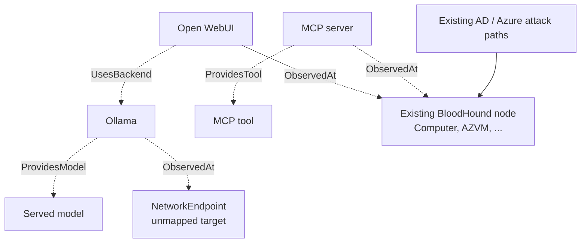

# LLMHound graph model

> **Status: target design, partly implemented.** Companion to the
> [design plan](../plans/2026-09-29-llmhound-design.md). M0 (CE 9.7.1 spike),
> M1 (graph, identity, emitter, config, `extension/schema.json`) and the M2a
> collectors are implemented on `QA`, but they follow the **earlier model**
> (`CollectionVantage`, access edges, suffix correlation). This document
> describes the target; the [Implementation delta](#implementation-delta) lists
> exactly where the code differs. CE behavior is recorded in
> [ce-compatibility.md](ce-compatibility.md).

This is the **canonical home** for node/edge kinds, identity, attachment to
existing nodes, the flat property contract, and the bar for traversable edges.
Other docs link here instead of restating these rules.

LLMHound adds AI-infrastructure facts to a BloodHound graph that SharpHound,
AzureHound, and similar collectors already built. The product question is
tier-0 pathing: *from this asset, what is the shortest path to tier 0, and
which paths cross hosts running AI services?* LLMHound supplies the AI-service
side of that join. A separate normalization program owns attribution and
cleanup.

## Naming contract

- **Kinds:** this document uses clean logical names (`OllamaInstance`,
  `MCPServer`, `ObservedAt`). CE 9.7.1 requires a mandatory, exclusively owned
  namespace prefix (M0 Q1), so emitted names are `LLMHound_<Kind>` (for example
  `LLMHound_OllamaInstance`, `LLMHound_ObservedAt`, umbrella
  `LLMHound_AIService`). `internal/graph/kinds.go` is the single mapping; the
  schema, payloads, and saved queries use emitted names. Native kinds such as
  `Computer` stay unqualified and are never emitted.
- **Property names:** emit lowercase (CE property names are case-sensitive).
  CE upper-cases node ids and the string values of `name`, so never put a
  value that must keep its case in `name`; use a dedicated property such as
  `host` or `endpoint`.
- **Display names:** describe the instance, e.g. `Ollama · ai-server-01:11434`.
- **Ownership:** extension/source metadata carries `LLMHound` and `source_kind`
  `LLMHound`. Never rely on kind-name prefixes.
- **Identity:** adapter qualification and display-name changes never change
  object IDs.

## At a glance

Services attach to the nodes the existing attack-path graph already reaches.
By default nothing LLMHound emits is traversable; the AD/Azure edges supply the
paths and LLMHound supplies the target set and context. The only exception is
the opt-in [path qualification](#path-qualification-traversable-edges) rules.

## Nodes

| Group | Kinds |
|---|---|
| Observed targets | existing BloodHound node (any kind; not emitted); `NetworkEndpoint` (fallback for unmapped targets) |
| MCP | `MCPServer`, `MCPTool`, `MCPResource`, `MCPPrompt` |
| A2A | `A2AAgent`, `A2ASkill` |
| AI services | `OllamaInstance`, `VLLMInstance`, `LiteLLMGateway`, `QdrantInstance`, `MLflowServer`, `JupyterServer`, `OpenWebUIInstance`, `LangServeApp` |
| AI services (M2c) | `OpenAICompatibleEndpoint`, `RayDashboard`, `LangflowInstance`, `FlowiseInstance`, `ChromaInstance` |
| Served models | `AIModel` |
| Typed resources | `VectorCollection`, `WorkspaceFile`, `ModelArtifact`, `ArtifactStore` |
| Umbrella label | `AIService` |

In edge tables, **service** means an MCP server, A2A agent, or AI-service
endpoint, not its child tools, skills, or resources.

- **`AIService`** is an extra label carried by **every concrete service kind**
  (`MCPServer`, `A2AAgent`, all AI-service kinds, M2c kinds). It is not carried
  by child nodes, `NetworkEndpoint`, or existing nodes, and never owns
  identity. If M0 shows multi-label is unsupported, saved queries are generated
  with explicit kind lists.
- **`NetworkEndpoint`** is the fallback for a target with no mapping entry. It
  is not necessarily an authoritative machine (it may be a proxy or shared
  address). It is the hand-off point: the normalizer attributes it later.
  IP and FQDN endpoints are never auto-merged.
- **`MCPServer`** is a fingerprinted network MCP endpoint; tools, resources,
  and prompts become child nodes. **`A2AAgent`** is an agent advertised by an
  agent card; advertisement is not evidence of invocation.
- **`OpenAICompatibleEndpoint`** (M2c) is the honest default when no specific
  product can be proven.
- **Service kinds** each represent a fingerprinted endpoint, not a guaranteed
  unique process or installation.
- An advertised backend URL alone does not establish product or availability.
  Keep it as a sanitized reference until independently fingerprinted; only
  then emit `UsesBackend`. Never scan a backend merely because it was
  advertised.
- **`AIModel`** is scoped to its serving service; record digests when
  available (a tag is mutable). **`VectorCollection`** is a Qdrant (or Chroma)
  collection; point and document samples go to the content file, not the graph. **`WorkspaceFile`** is a Jupyter
  entry from the contents API; listing is not reading. **`ModelArtifact`** is a
  registered MLflow model version. **`ArtifactStore`** is a reported storage
  root, scoped to the reporting service; bucket names and paths do not prove
  access or global uniqueness.

## Identity

SHA-256 over an unambiguously serialized, versioned tuple. Every identity
includes the source identifier, deployment scope (stable configuration, not a
secret or per-scan ID), and logical kind.

| Node | Additional identity fields |
|---|---|
| NetworkEndpoint | Normalized target type and target value |
| Service | Canonical endpoint: scheme, hostname/IP, effective port, base path |
| Child resource/model | Owning service ID and exact stable resource key |

Resource keys: collection name, model name, MCP resource URI/tool name,
workspace path, registered model name and version. Preserve case where the
protocol is case-sensitive; normalize DNS case and IP representation; define and
test default-port and base-path handling. Do not collapse distinct virtual
hosts or path-mounted services. Credentials, fragments, query strings, display
names, versions, timestamps, and descriptions never enter identity; endpoints
distinguishable only by excluded secret/query material need an explicit
configured instance key.

### Implemented identity v1

`internal/graph/identity.go` hashes a JSON string-array tuple beginning with
`["1", "LLMHound", deployment_scope, logical_kind, ...]`; the SHA-256 hex is
upper-case to match CE's id normalization. Native node IDs are preserved
verbatim, never hashed or rewritten. Resource ownership is the scoped concrete
service ID; stable keys retain case and are not trimmed. `ParseEndpoint`
(HTTP/HTTPS) normalizes as follows:

- DNS names are ASCII (A-labels for international names), lower-case, without
  one terminal dot; IPs use canonical `net/netip` spelling. Zoned IPs and
  malformed numeric addresses are rejected, including names whose final label
  is all digits or starts with `0x` (`example.123`, `0x7f.0.0.1`).
- Omitted ports are 80/443; explicit default ports and leading-zero decimal
  spellings normalize to the same effective port. Schemes stay distinct.
- Empty path and `/` are equivalent. Unreserved percent escapes normalize to
  literals; remaining escapes use upper-case hex; escaped `/` is not a
  separator. Path case, non-root trailing slash, repeated slashes and dot
  segments are preserved because server semantics may differ.
- Userinfo and fragments fail closed. A query-bearing endpoint requires an
  explicit **non-secret instance key** that enters identity; the query itself is
  neither retained nor hashed. Mutable credentials or query values must not
  become instance keys.

`ParseTarget` accepts bare DNS/IP targets independently of service URLs.
IP/FQDN coincidence, shared certificates, and redirects never unify identities.

Repeated observations keep their ID. That does not prove an IP-backed
installation stayed the same. Run IDs and observation times are provenance,
never identity. One **vantage** (the configured `vantage_key`, e.g. the scanner
VM's network context) applies per deployment scope; scan from a materially
different network context under a different scope.

## Attachment to existing nodes

LLMHound does not attribute targets itself. Attribution is an input:

- **Asset mapping file** (supplied by the normalization program): target (IP,
  FQDN, or `host:port`) → BloodHound `objectid` **and node kind**. The kind may
  be anything already in the graph: AD `Computer`, `AZVM`, an Entra device, and
  so on. Each entry must point at a node that exists: the mapping is the
  normalizer's assertion, and `upload` re-verifies it (below).
- A mapped target gets `ObservedAt` (service → existing node) carrying
  `match_method = mapping_file`, `match_value`, and `mapping_source`
  (a mapping-file revision or ID supplied with the file). No `NetworkEndpoint`
  is created.
- An unmapped target gets `ObservedAt` → `NetworkEndpoint`, plus the reason in
  the evidence sidecar. A target mapped to several objectids is treated as
  unmapped, with the candidates recorded; LLMHound never picks one.
- Attachment is **an edge to an existing node, not an identity merge**.
  Service objectids never depend on it, native BloodHound IDs are never
  overwritten, and LLMHound never emits or modifies nodes of native kinds.
- No suffix matching, reverse DNS, or CE-side attribution in LLMHound; those
  belong to the normalizer. (Suffix matching exists in the M1 code; see the
  [delta](#implementation-delta).)
- **Why existence matters (M0 Q5/Q6):** an edge to a missing `match_by: id`
  endpoint makes CE create an empty, kindless **stub node**, and a property
  match with zero or several hits is silently dropped. So an attachment edge is
  emitted only for a mapping entry whose destination is verified, and `upload`
  runs a read-only existence pre-flight against CE before sending the linking
  payload, skipping and reporting entries that fail (M3).
- **Upload shape (M0 Q5):** a payload that declares `metadata.source_kind`
  tags every node it references, including existing `Computer`s, and source
  cleanup then deletes them. So each scan uploads in two steps:
  (1) the LLMHound-owned subgraph with `source_kind: LLMHound` (including
  edges to `NetworkEndpoint`), then (2) a **linking payload without
  `source_kind`** holding `ObservedAt` edges to existing native nodes.
  Linking edges are therefore sourceless data, not removed by source cleanup;
  the normalizer owns their lifecycle.

## Edges

All edges are non-traversable unless emitted by an enabled
[path qualification](#path-qualification-traversable-edges) rule.

| Edge | Source → target | Meaning |
|---|---|---|
| `ObservedAt` | service → existing node / NetworkEndpoint | Fingerprinted endpoint was observed through this target |
| `RunsOn` | service → existing node / NetworkEndpoint | Reserved for supported runtime placement; listening at an address alone is insufficient |
| `ProvidesTool` | MCPServer → MCPTool | Tool enumerated, not executed |
| `ProvidesResource` | MCPServer → MCPResource | Resource enumerated, not necessarily read |
| `ProvidesPrompt` | MCPServer → MCPPrompt | Prompt enumerated |
| `ProvidesModel` | service → AIModel | Model advertised by the runtime; inference not implied |
| `AdvertisesSkill` | A2AAgent → A2ASkill | Skill advertised, not invoked |
| `UsesBackend` | service → service | Dependency reported by the source, not proof of backend access |
| `Contains` | service → typed resource | Collection, workspace, model artifact, or artifact store association |

Edges to existing native nodes are emitted in the sourceless linking payload
described under [Attachment](#attachment-to-existing-nodes).

Anonymous access is **not an edge**. It is recorded as flat properties
(`anon_operations`, `auth_observed`) on the service or resource, scoped by
`vantage_key` and `last_observed`. This keeps access queryable with plain
property filters and avoids edge-multiplicity assumptions.

## Property contract

Properties are flat and queryable; they are driven by the
[saved queries](saved-queries.md) and by the tier-0 pathing questions. Bounded
structured evidence that graph properties cannot represent goes to the
`.evidence.jsonl` sidecar, referenced by `evidence_ids`.

**Min-max principle:** within the anonymous, allowlisted, read-only policy,
collect every metadata field that helps answer one of: *what is it* (identity,
version), *can an attacker reach and use it* (auth, exposure, execution
surface), *what does it touch* (backends, stores, models, credentials
referenced), or *who/what is it attached to*. Prefer a flat property over
sidecar-only storage when a query would filter on it. Label every value as
`observed`, `declared` (advertised by the service), or `inferred` (derived by a
documented rule). Unknown stays unknown. **Positive claims are
precision-first:** a boolean or classification is set only on deterministic
evidence; anything ambiguous stays unknown or unset, never guessed, and an
unknown or unset value never implies absence.

Service properties (logical names; final serialization is fixed in M1 from the
M0 answers):

| Group | Properties |
|---|---|
| Endpoint | `scheme`, `host`, `port`, `base_path`, `endpoint` (canonical) |
| Product | `product`, `vendor`, `software_version_raw`, `software_version`, `build_id`, `commit`, `image_digest`, `api_version`, `protocol_version`, each with `*_source` and `*_basis` |
| Auth | `auth_advertised` (`none`/`required`/`mixed`/`unknown`, `declared`), `auth_observed` (`anonymous`/`denied`/`mixed`/`unknown`, `observed`), `anon_operations` (array of succeeded `check_id`s only) |
| Execution surface | `exec_surface` (array: `code_kernel`, `terminal`, `job_submit`, `code_eval`, `workflow_exec`, `tool_invocation`, `model_mutation`, `unknown`; only positively identified surfaces are listed), `exec_surface_basis` (`observed`/`declared`/`inferred`) |
| Dependencies | `backend_refs` (sanitized array), `store_refs` (sanitized array), `backend_refs_basis` |
| Inventory | `model_count`, `tool_count`, `resource_count`, `collection_count` (as applicable) |
| Content | `system_prompt_present`, `config_collected`, `content_bytes`, `content_truncated`, `has_exposed_secret` (`true` or unset), `secret_last_confirmed`, `secret_types` (array); bodies and secret values never appear in the graph, see [Content and secrets](#content-and-secrets) |
| TLS | `tls_verification` (`ok`/`failed`/`insecure_override`/`n_a`), `tls_failure_reason`, `tls_leaf_sha256`, `tls_issuer`, `tls_not_after` |
| Provenance | `source`, `schema_version`, `scan_id`, `vantage_key`, `first_observed`, `last_observed`, `coverage`, `coverage_reason`, `mapping_source` |

Child resources carry the subset that applies (`anon_operations`, `*_basis`,
`last_observed`, `scan_id`, plus resource-specific fields such as `digest`,
`size_bytes`, `dimensions`, `stage`). MCP tools additionally carry
`description_excerpt`, `input_schema_summary`, `annotations`, and
`capability_hint` (array: `shell`, `filesystem`, `network`, `database`,
`browser`, `secrets`, `code`) with `capability_hint_basis = declared`.
`capability_hint` is a heuristic over untrusted descriptions, never evidence of
behavior.

Tool, prompt, and descriptor text is attacker-controlled. Bound its length,
strip control characters, and treat it as untrusted by any consumer, including
downstream LLM tooling.

**CE constraints that shape this contract (M0 Q3, Q8):** properties must be
strings, numbers, booleans, or homogeneous arrays of those (nested objects and
mixed arrays are rejected at upload); node properties **merge** on re-upload and
CE **never removes a stale property**. So every scan re-emits the full current
value of each status property (`auth_observed`, `anon_operations`,
`exec_surface`, `coverage`, and so on). The one exception is a flag that is
only ever `true` or unset, such as `has_exposed_secret`: a later scan cannot
unset it, so it is always accompanied by `secret_last_confirmed` (UTC time of
the most recent scan that re-detected it), and consumers must read the flag
together with that timestamp. Reconciliation of old values belongs to the
normalizer.

Missing version data is **unknown**. Record conflicting fingerprints rather
than silently keeping the latest. Component, API, protocol, registry, and model
versions stay distinct; a proxy banner is not a backend version.

### Per-check results

Each check records `check_id`, target, scan ID, vantage key, operation,
sanitized source, UTC time, outcome (`success`, `denied`, `unsupported`,
`failed`, `skipped`), reason, and evidence references; definitions and the 404
rule are in the [capability matrix](collector-capabilities.md#per-check-result-contract).
Negative and unknown results live in the sidecar, not in positive properties.

### Coverage

Per collection surface and operation, never a claim the host was fully
assessed: `complete`, `partial` (some operations failed), `truncated` (a bound
stopped enumeration), `failed` (could not enumerate; discovery failures create
no fingerprinted service). Check outcome and coverage are independent.

### Content and secrets

The **content tier** is existing content a service returns through an
allowlisted, read-only, anonymous operation: system prompts, modelfiles and
templates, configuration, notebook and file bodies, flow definitions, job
metadata, MCP resource bodies, small text artifacts, and bounded vector
point/document samples. It is collected **by default when one allowlisted
anonymous read returns it** (no crawling, no multi-step extraction) and can be
disabled globally or per surface in `llmhound.yaml`.

- **Bounds:** per-item, per-resource, and per-service byte and item caps
  (defaults: 256 KiB per item, 10 items per resource, 5 MiB per service, 5
  sample points per collection). Hitting a bound records `truncated`.
- **Never collected:** model weights and other binary blobs, embeddings, full
  database dumps, or anything requiring a mutating or workload-initiating call.
- **Where it goes:** content bodies are written only to a restricted
  `.content.jsonl` (file mode 0600), never into the OpenGraph payload or the
  shareable evidence sidecar. The graph carries only flags, sizes, and hashes
  (`system_prompt_present`, `config_collected`, `content_bytes`,
  `content_truncated`, `has_exposed_secret`, `secret_last_confirmed`,
  `secret_types`).
- **Secrets are a boolean, never a value.** A matched secret is recorded as
  presence only: type and location (path/field/line) in the evidence sidecar,
  and `has_exposed_secret = true` plus `secret_types` on the graph node. The raw
  value is discarded at detection time. It is never written to the payload,
  sidecar, `.content.jsonl` (the span is replaced by `[secret:<type>]`),
  checkpoints, or logs, and there is no secrets file.
- **Precision over recall.** A false positive is worse than a miss in a large
  environment, so only **high-precision detectors** may set the flag. A
  detector qualifies only if a match is structurally verifiable without
  contacting any service: a parsable PEM private-key block; a token format with
  a defined prefix and an embedded checksum that validates (for example vendor
  tokens with CRC fields); a structurally valid JWT (decodable header and
  payload with required claims) that is not an example; a cloud access-key pair
  matching the documented format together with its paired secret in the same
  object; a connection string whose scheme is documented and whose userinfo is
  non-empty and not a placeholder. **No** entropy, keyword, or "looks like a
  key" heuristics. Known placeholders and documentation examples
  (`changeme`, `xxxx`, `<your-key>`, vendor-published sample keys, `EXAMPLE`
  suffixes, all-same-character values) never match. Each detector ships with a
  fixture corpus of true positives and look-alike negatives, and a detector
  that cannot meet a zero-false-positive corpus does not ship.
- **Absence is not a claim.** `has_exposed_secret` is only ever `true` or
  unset. Unset means "no high-precision match", not "no secret present".
  Queries must never treat unset as clean.
- **Boundary:** LLMHound reads what a service serves anonymously. It does not
  guess, brute-force, or try default credentials, and it never uses,
  validates, or sends a found credential to any service. Using a credential is
  credentialed enumeration (M4) and needs its own authorization.
- **Graph properties stay clean regardless:** credentials, authorization
  headers, URL userinfo, and signed query parameters are stripped from every
  structured property (`backend_refs`, endpoints, and so on).
- The content file needs documented retention, deletion, and access controls
  (prompts and configuration can still be sensitive). Do not ship it through
  the ingest pipeline that feeds BloodHound.

## Path qualification (traversable edges)

Default: nothing LLMHound emits is traversable, because a listening AI service
is not an attack transition. An edge may become traversable **only** through a
named rule that clears every criterion below. Rules ship disabled and are
enabled per rule in `llmhound.yaml`.

| # | Criterion |
|---|---|
| 1 | **Capability class from a closed list.** v1 rules may claim only **code execution on the host**. File read and secret disclosure are reserved classes that would need their own edge kinds and a separate decision. Not "tool exists", "model served", or "port open" |
| 2 | **Positive evidence:** at least one observed anonymous success of a read-only check whose success is, per documented product semantics, only possible when the capability is open (e.g. auth is disabled). Advertisements, tool descriptions, and version banners alone never qualify. LLMHound never executes the capability to prove it |
| 3 | **Documented rule:** a rule ID and version, the product and version range it holds for, the official documentation cited, and the check IDs it depends on. Unknown or out-of-range versions do not qualify |
| 4 | **Verified attachment:** the end node is an existing node from the mapping file. Never a `NetworkEndpoint` |
| 5 | **Explicit start population:** the edge starts at operator-configured `assumed_reach_principals` (e.g. Domain Users or Authenticated Users). Network reachability is observed from the scan vantage only; the edge records `reach_basis = scanner_vantage` so consumers can see the assumption |
| 6 | **Provenance:** edge carries `rule_id`, `rule_version`, `basis` (`inferred`), `confidence`, `operations`, `evidence_ids`, and `exec_identity = unknown` unless observed |

Reserved edge kind: `CanExecuteOn` (principal group → existing node), emitted
only by a rule. The service remains the evidence node; the edge is the
transition. Execution identity is not guessed: an edge to the host means "code
execution on this host as the service's account", which may not be privileged.

**Candidate rules** (unvalidated; each needs official documentation, a
product/version range, and fixtures before it exists): Jupyter with
authentication disabled; Ray dashboard with anonymous job-submission API;
Langflow with unauthenticated/auto-login access on affected versions.

**Do not qualify:** advertised MCP/A2A tools or skills, anonymous model
listing, vector-store or registry inventory, any state based on a login page, a
TCP probe, a version banner, or a shared certificate. Qualification never
depends on FQDN matching or `RunsOn`.

Rules live in `extension/rules/` as data with their own tests. A rule that
cannot be validated against the pinned CE does not ship. M0 Q4 confirmed that
pathfinding honors `is_traversable: false` and that raw search still returns
non-traversable edges; that an `is_traversable: true` rule edge is honored by
`only_traversable` pathfinding is still open (R5 in
[ce-compatibility.md](ce-compatibility.md)).

## Source ownership and lifecycle

LLMHound-owned nodes and edges carry `source_kind` `LLMHound` (the linking
payload to native nodes deliberately does not; see
[Attachment](#attachment-to-existing-nodes)). LLMHound stamps accurate
observation times, scan ID, and coverage, and never claims removal: a failed,
partial, or truncated scan is not evidence a service or child disappeared.
Attribution, reconciliation, staleness, and cleanup belong to the
normalization program. LLMHound never emits or modifies native-kind nodes.
Resume retains original observation timestamps.

## Implementation delta

What is on `QA` today versus this target design. Docs that describe the
implemented behavior as it stands, and remain accurate for the code, are
[configuration](configuration.md), [m2a-integration](m2a-integration.md),
[checkpoint-journal](checkpoint-journal.md),
[jupyter-collector](jupyter-collector.md) and
[ollama-collector](ollama-collector.md).

| Area | Implemented on `QA` | Target |
|---|---|---|
| Access evidence | `CollectionVantage` node plus `UnauthenticatedAccess` / `PublicAccess` edges (`internal/graph`, emitter, schema) | Remove; flat `anon_operations` / `auth_observed` / `vantage_key` properties |
| Attachment target kind | `Computer` only | Any existing native kind (`AZVM`, Entra devices, ...) |
| Correlation | Mapping file plus AD-suffix property match against a caller-supplied verified inventory; `ad_domain_suffixes`, `reverse_dns`, `ce_lookup` config fields | Mapping file only; suffix, reverse DNS, and CE lookup superseded by the normalizer. Upload pre-flight verifies existence |
| Sensitive content | `opt_ins.{resource_content,prompts,configuration_content,workspace_content}`, default false; no content reads | Content tier on by default and bounded (`content.*`), restricted `.content.jsonl`, `secrets` detector toggles |
| Secret detection | None | High-precision detectors, `has_exposed_secret` / `secret_types` / `secret_last_confirmed` |
| Flat property contract | The properties emitted today | The full [property contract](#property-contract) |
| Traversability | `EdgeKind.IsTraversable()` is always false | Rule-gated `CanExecuteOn` (M2d) |
| Upload | `upload` is a not-implemented stub (M3); the emitter already writes a sourceless linking payload | Two-step upload with existence pre-flight |

Closing the delta is a code change; until then, trust the code for what a
build does and this document for what it should do.

## Implementation acceptance checks

- Identity goldens: scope separation, case-sensitive resource keys, virtual
  hosts, path-mounted services, repeat scans, IP/FQDN ambiguity.
- Attachment: mapped target (any node kind), unmapped target, target mapped to
  several objectids, mapped destination missing from the graph (no stub node),
  service IDs unchanged by mapping, native kinds never emitted, and the linking
  payload carries no `source_kind`.
- Access properties: `anon_operations` contains only successes; denied and
  unknown outcomes appear only in the sidecar; login pages, advertised tools,
  and TCP probes never create access claims.
- `ObservedAt` does not imply `RunsOn`.
- Property contract: every property used by a saved query is flat, typed, and
  labeled `observed`/`declared`/`inferred`.
- Version honesty: unknown versions and conflicting observations survive
  emission; component, API/protocol, and model versions stay distinct.
- Capability-matrix fixtures preserve per-check outcomes, TLS verification vs
  override, and scoped redirects.
- Content tier: bounds enforced and truncation recorded; bodies appear only in
  `.content.jsonl`; model weights and embeddings are never fetched; no
  credential is ever sent to any service.
- Secret detection: every detector has a true-positive corpus and a
  look-alike negative corpus with zero false positives (placeholders, vendor
  sample keys, malformed tokens, high-entropy non-secrets); a planted secret
  sets `has_exposed_secret` and its value appears nowhere (payload, sidecar,
  content file, logs, checkpoints); unset is never emitted as `false`.
- Size limits and no-backend-following hold across exports, logs, and
  checkpoints.
- Path qualification: with all rules disabled, every emitted edge is
  non-traversable; each enabled rule fails closed on unknown version, missing
  evidence, or unmapped target, and emits all required provenance.
- Pinned CE: payload/schema, kinds, property types (incl. arrays), edge
  endpoint resolution, non-traversable vs rule-enabled behavior in pathfinding,
  and repeat ingest.

## Reserved for future milestones

- Credential-driven enumeration and credential-to-resource access evidence (M4).
- Per-kind property reference and description pages (M5).
